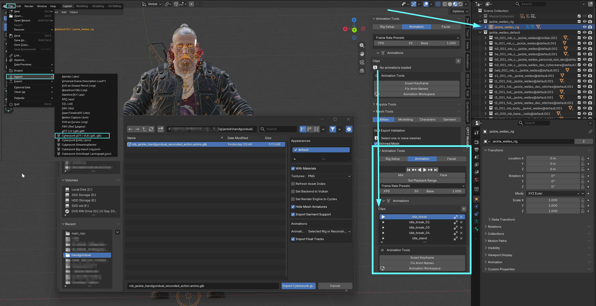

# WKit Blender Plugin: Animation tools

## Summary

Published: November 8 2026 by [mana vortex](https://app.gitbook.com/u/NfZBoxGegfUqB33J9HXuCs6PVaC3 "mention")\
Last documented update: November 8 2026 by [mana vortex](https://app.gitbook.com/u/NfZBoxGegfUqB33J9HXuCs6PVaC3 "mention")

This page explains the UI for the [Wolvenkit Blender IO suite](./)'s animation tools. It is a work in progress.



### Importing and using .anims

1. Select an existing armature in the outliner
2. Import an .anims.glb file from the game
3. Play the imported animation tracks straight from the **Clips** panel

<figure><figcaption></figcaption></figure>

