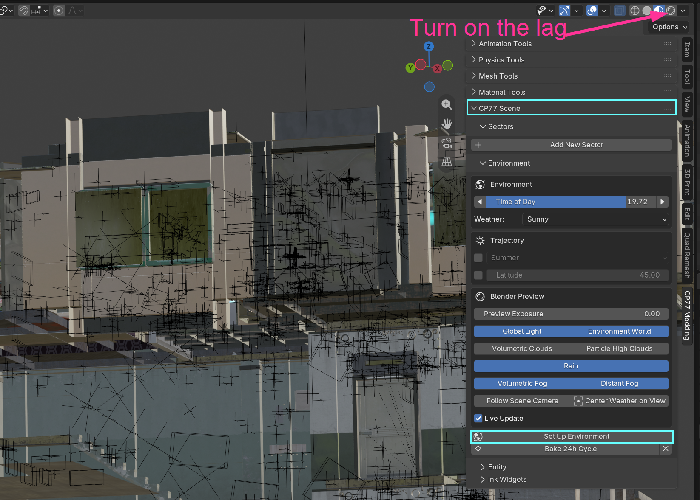

# WKit Blender Plugin: Scene tools

## Summary

Published: November 8 2026 by [mana vortex](https://app.gitbook.com/u/NfZBoxGegfUqB33J9HXuCs6PVaC3 "mention")\
Last documented update: November 8 2026 by [mana vortex](https://app.gitbook.com/u/NfZBoxGegfUqB33J9HXuCs6PVaC3 "mention")

This page explains the UI for the [Wolvenkit Blender IO suite](./)'s scene tools. It is a work in progress and there are still undocumented features. If you want to contribute, please do!


Even on the Tesseract, creating a render of complex game environments will never be instant. For a small scene, be prepared to wait for several minutes — for larger setups, a full render can take hours or even days.


## Importing and rendering a sector

This is covered in detail on [#streaming-sectors](wkit-blender-plugin-import-export.md#streaming-sectors "mention"). Just as a quick reminder:

* Add the sector(s) that you want to your project (check [reference-world-sectors](../../references-lists-and-overviews/reference-world-sectors/ "mention") for a list)
* Run the `Export_Sector` script
* Import `Cyberpunk Streamingsector` and load your project's `.cdproj` file&#x20;

... and now wait. Depending on how beefy your PC is, this can take a long time.

### Set up the environment

The first step for your render is to set up the environment. Hit the button at the bottom of the panel, then wait while everything is initialized.


To really see your changes, you must switch the viewport to Rendered (the 4th orb at the top right, pink arrow on the image below). Be aware that this tank your performance, even if you turn off Live Update at the bottom.


<figure><figcaption></figcaption></figure>

You can influence the scene render settings by tweaking any of the panels.&#x20;

### Bake 24h Cycle

By pressing the `Bake 24h Cycle` button, you can give your hardware a workout while simultaneously heating your room.

This will create (bake) an animation. You can play it with the space key, or if you (like me) have bound that to something more useful, from the menu under `Blender` -> `System` -> `Redraw Timer` -> `Animation Play`.

### Export to anim&#x20;

From the menu, select `Render` -> `Render Animation` , and pick a target folder:

<figure><figcaption></figcaption></figure>


You can set the max samples to 256 without losing too much quality.


This gives you one image for every single frame, which you can then compile into a video like the one below.

{% embed url="https://files.gitbook.com/v0/b/gitbook-x-prod.appspot.com/o/spaces%2F4gzcGtLrr90pVjAWVdTc%2Fuploads%2F9Kcg5DONS8WSZ0UOaj8x%2F24h_render_cycle.mp4?alt=media&token=244f50dc-e772-4e65-8193-b2bdbc9b0a9c" %}
