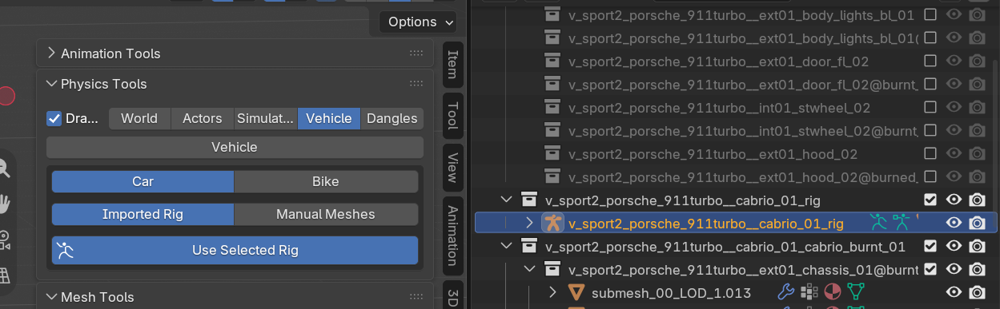
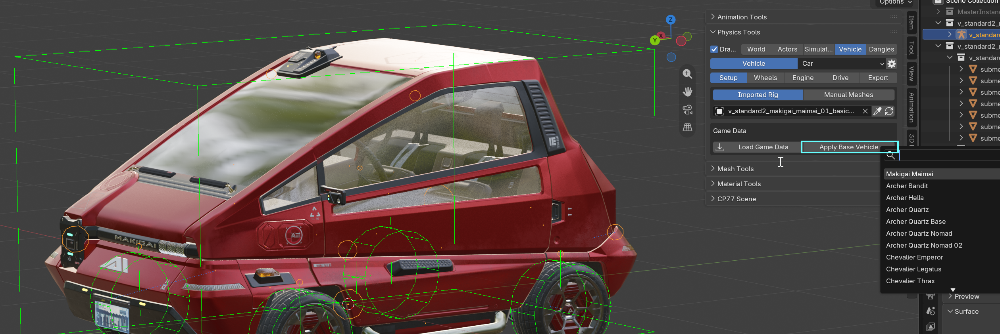
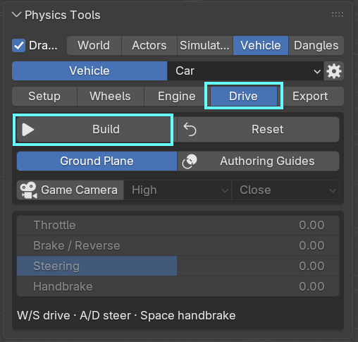
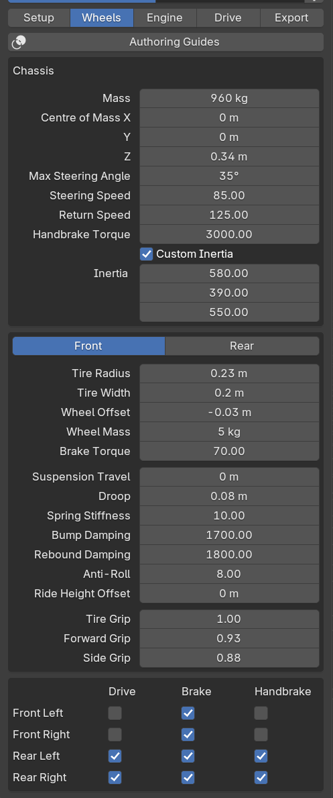
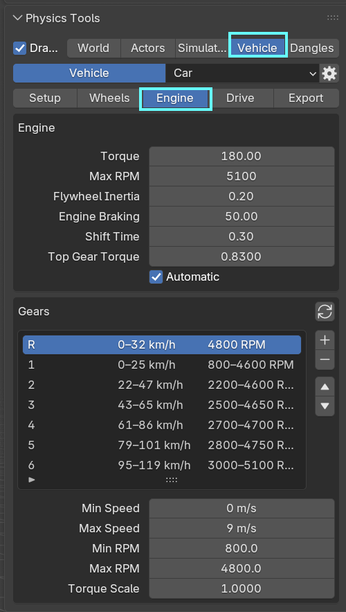
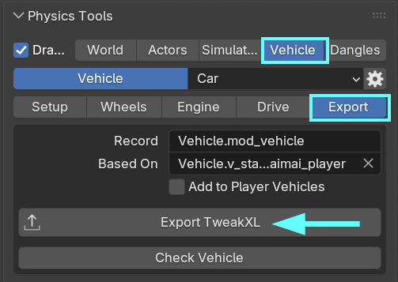

# WKit Blender Plugin: Scene tools

## Summary

Published: November 8 2026 by [mana vortex](https://app.gitbook.com/u/NfZBoxGegfUqB33J9HXuCs6PVaC3 "mention")\
Last documented update: November 8 2026 by [mana vortex](https://app.gitbook.com/u/NfZBoxGegfUqB33J9HXuCs6PVaC3 "mention")

This page tells you how to use the [.](./ "mention") for vehicle modding and -tweaking.&#x20;

### Wait, this is not what I want!

* For a detailed guide on how to create a car mod, check [boe6s-guide-new-car-from-a-to-z](../../../modding-guides/vehicles/boe6s-guide-new-car-from-a-to-z/ "mention")

## Driving a vehicle

You have imported a vehicle `.ent.json` — how do you make it drive?

### Loading a rig

1. Select its armature in the Outliner panel
2. In the Physics Tool panel, switch to the `Vehicle` tab&#x20;
3. Optional: Switch the vehicle type from `Car` to `Bike`

* Click on the `Use Selected Rig`  button

<figure><figcaption></figcaption></figure>

The addon will need a moment to initialize everything.

You will now see several tabs: `Setup`, `Wheels`, `Engine`, `Drive`, and `Export`.

### Adding physics

To move the vehicle, the plugin needs a `.phys` file. You can import a `phys.json` from the game, or use one of the bundled base game vehicles

1. Switch to the `Setup` tab (you should be there already)
2. Click the `Apply Base Vehicle` button and select your wheels

<figure><figcaption></figcaption></figure>

### Initializing Drive Data

Before we can go for a ride, we need something to drive on. Let's initialize that, too:

1. Switch to the **Drive** tab

<figure><figcaption></figcaption></figure>

2. Click the "Build" button
3. **Optional:** Click the `Game Camera` button to get a camera that follows your car. Use the dropdowns to configure angle and distance.
4. **Optional:** Play with the settings in the window — the car will handle differently depending on your settings for `Throttle`, `Brake/Reverse`, `Steering`, and `Handbrake`.

### Drive!

Switch from The `Vehicle` to the `Simulation` tab, and hit the Start button. Here's the controls:

W: Gas, go faster\
S:  Brake, not this fast\
A/D: Right/left\
Space: Handbrake

<figure><figcaption></figcaption></figure>

Watch it in action

{% embed url="https://files.gitbook.com/v0/b/gitbook-x-prod.appspot.com/o/spaces%2F4gzcGtLrr90pVjAWVdTc%2Fuploads%2FENj2h8ER0QYR3pfz7YyP%2Fvehicle_driving.mp4?alt=media&token=d265d079-fcb7-46e2-bed4-7e1112da1cbe" %}

## Vehicle Configuration and Customization

Starting with version 2.5, you can now change your vehicle's properties directly in Blender and export the result directly to a TweakXL-ready yaml file.&#x20;

Open the `Physics Tools` and switch to the `Vehicle` tab.&#x20;


You need to initially select your vehicle's .rig, see [#driving-a-vehicle](wkit-blender-plugin-scene-tools.md#driving-a-vehicle "mention") for a step-by-step guide.


### Setup

If you have not completed this step, the other tabs won't be visible. This is where you can pick your vehicle's basic settings; see [#driving-a-vehicle](wkit-blender-plugin-scene-tools.md#driving-a-vehicle "mention") for a more detailed guide.

### Wheels

Here you can configure your vehicle's properties. These value correspond to the [Cheat Sheet: Vehicle Properties](https://app.gitbook.com/s/V8IFViBI9k2aiwNySH5C/for-mod-creators-theory/references-lists-and-overviews/vehicles/vehicle-drive-model-data-record "mention").

<table data-header-hidden><thead><tr><th></th><th valign="top"></th></tr></thead><tbody><tr><td></td><td valign="top">
<strong>Chassis:</strong>  Here you can configure the weight and handling of the car's body (the non-moving parts)

<strong>Front/Rear</strong>: This section lets you tweak your wheels (the moving parts of the ride). 

<strong>Drive/Brake/Handbrake:</strong>

Whether or not a wheel is affected. For example, the Maimai has a rear-wheel drive and -handbrake, where a motorbike's has a rear-wheel drive and the handbrake affects the front wheel.
</td></tr></tbody></table>

### Engine

Here you can configure your vehicle's engines properties (the thing inside the chassis that makes the ride go zoom).&#x20;

<table data-header-hidden><thead><tr><th></th><th valign="top"></th></tr></thead><tbody><tr><td></td><td valign="top">Check <a data-mention href="https://app.gitbook.com/s/V8IFViBI9k2aiwNySH5C/for-mod-creators-theory/references-lists-and-overviews/vehicles/vehicle-drive-model-data-record">Cheat Sheet: Vehicle Properties</a> for an annotated list on which property does what.</td></tr></tbody></table>

### Drive

This tab lets you initialize your car for driving. Check [#driving-a-vehicle](wkit-blender-plugin-scene-tools.md#driving-a-vehicle "mention") -> [#initializing-drive-data](wkit-blender-plugin-scene-tools.md#initializing-drive-data "mention") for a detailed explanation.

### Export

On this tab, you can export your tweaked vehicle to a game-ready .yaml file:

<figure><figcaption></figcaption></figure>

**Record:** lets you customize the record name, e.g. `Vehicle.my_cool_new_ride`\
**Based On**: Selects the record's `$base` property. This should be an existing vehicle.\
**Add to Player Vehicle**: Sets the property to treat this as a player vehicle\
**Check Vehicle:** Tries to validate your changes and warn you if anything is fubar\
**Export TweakXL**: Press this button to actually write the file. This should go into your Wolvenkit project's `resources` directory in the subfolder `r6/tweaks`, or directly into the same subfolder in your [Cyberpunk game folder](../../../for-mod-users/users-modding-cyberpunk-2077/the-cyberpunk-2077-game-directory/).
