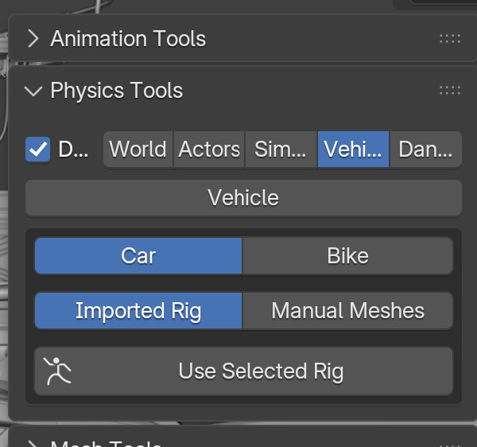
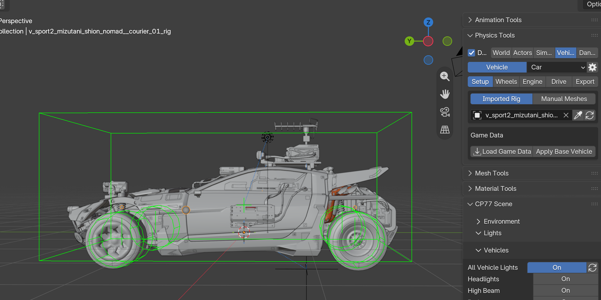

# WKit Blender Plugin: Vehicle customization

## Summary

Published: November 8 2026 by [mana vortex](https://app.gitbook.com/u/NfZBoxGegfUqB33J9HXuCs6PVaC3 "mention")\
Last documented update: November 8 2026 by [mana vortex](https://app.gitbook.com/u/NfZBoxGegfUqB33J9HXuCs6PVaC3 "mention")



<figure><figcaption></figcaption></figure>

## Vehicle driving

1. Select a rig
2. Go to the vehicles tab of Physics tools\
   
3. Use selected rig\
   

{% embed url="https://files.gitbook.com/v0/b/gitbook-x-prod.appspot.com/o/spaces%2F4gzcGtLrr90pVjAWVdTc%2Fuploads%2FENj2h8ER0QYR3pfz7YyP%2Fvehicle_driving.mp4?alt=media&token=d265d079-fcb7-46e2-bed4-7e1112da1cbe" %}
