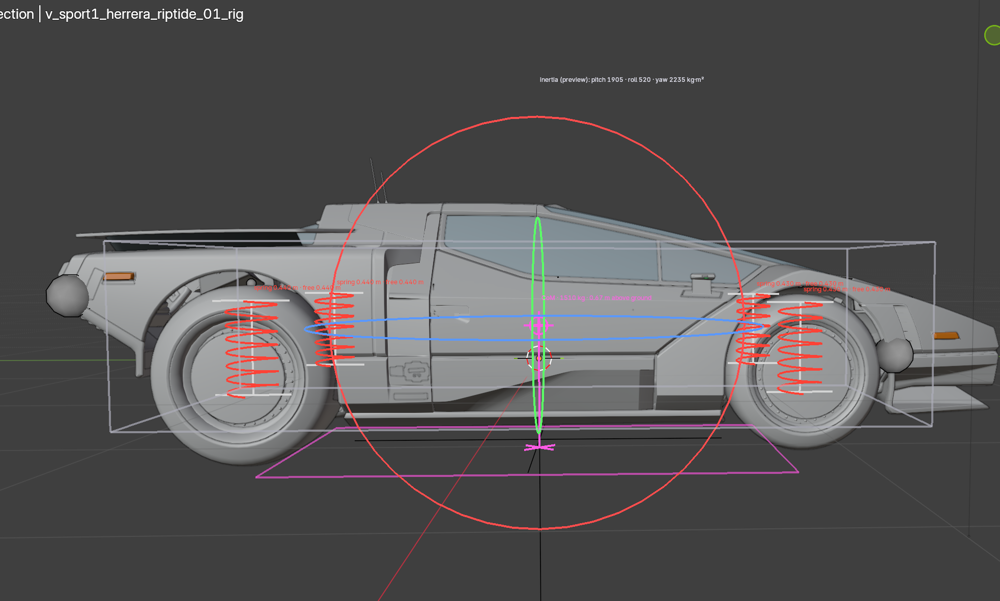

# WKit Blender Plugin: Vehicle customization

## Summary

Published: November 8 2026 by [mana vortex](https://app.gitbook.com/u/NfZBoxGegfUqB33J9HXuCs6PVaC3 "mention")\
Last documented update: November 8 2026 by [mana vortex](https://app.gitbook.com/u/NfZBoxGegfUqB33J9HXuCs6PVaC3 "mention")



<figure><figcaption></figcaption></figure>
