# Adding street name signs to the world

This guide is intended for peope who wish to:

* add/edit signs for existing street names (including highway signs)
* create new street names and use them on signs
* add/edit district colour schemes

### Pre-requisites

* have WolvenKit installed
* have World Builder installed, preferably Akiway's fork: [https://github.com/Akiway/CP77\_entSpawner](https://github.com/Akiway/CP77_entSpawner)
* for adding new street names, TweakXL will need to be installed

## Creating a sign and editing its data

First, go to the `Spawned` tab and create a group with a sensible name, e.g. the name(s) of the road(s) which the sign is for.

<figure>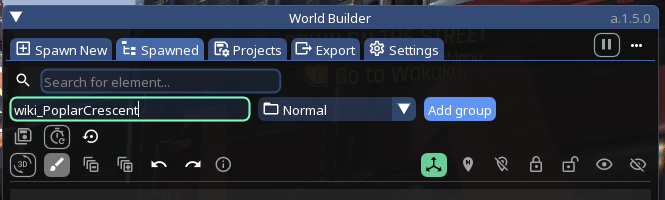<figcaption></figcaption></figure>


I am at the junction of Poplar and Crescent, and I gave the group a prefix of `wiki_` so that it is easy to tell what the group file is for (in case I ever need to look at the object files folder). The Projects feature of Akiway's fork also helps with organising groups but is beyond the scope of this guide.


Then, go to the `Spawn New` tab and search for the sign entities. I recommend setting the `Object type` to `Entity`, as we need the entities and not just the meshes.

* `street_signs\street` will give the smaller street signs - the main ones of interest are signs a, b and d
* `road_signs\highway` will give the larger highway signs - there are lots of configurations which can be chosen based on the needs of the road they are placed on (e.g. number of lanes)

<div><figure>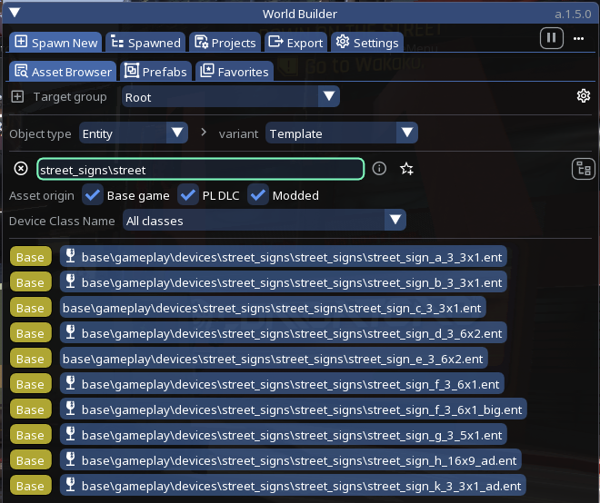<figcaption></figcaption></figure> <figure>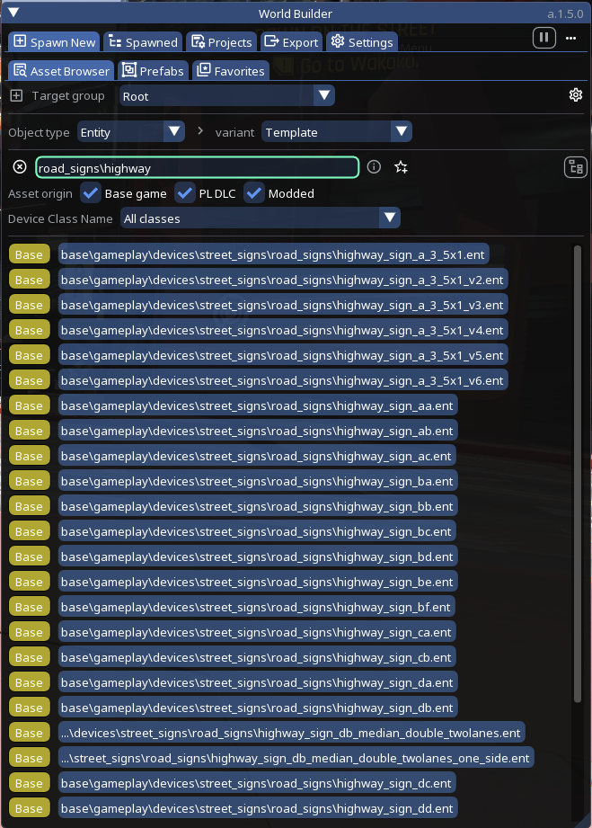<figcaption></figcaption></figure></div>

I will use `street_sign_a_3_3x1.ent` for the first example. Highway signs are slightly more complicated; they are covered [later](adding-street-name-signs-to-the-world.md#highway-sign-data).

Click the list item to spawn it, then go back to the `Spawned` tab and drag the sign into the group, and click the sign so the properties appear at the bottom. Go to `Entity Instance Data` -> `StreetSignWidgetComponent | UI` -> `streetNameSignTDBID`. This is where a TweakDB ID is set which tells the sign what name/district it should display (for street signs; highway signs are different).

<figure>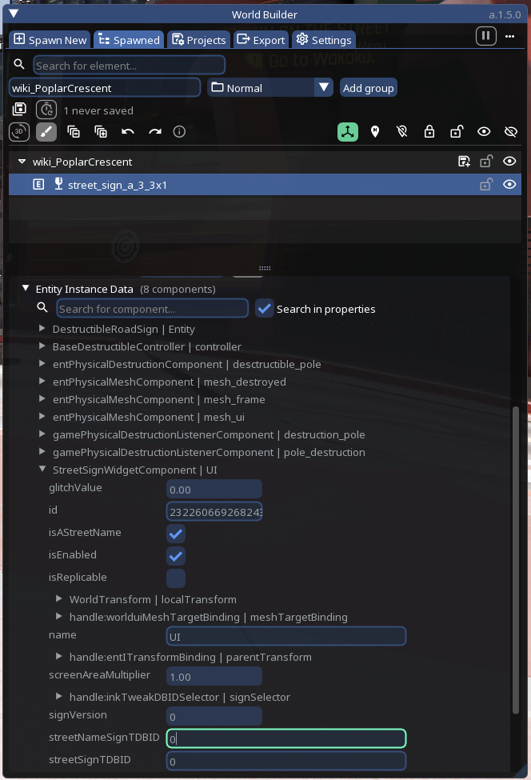<figcaption></figcaption></figure>


You may notice that there are several other entries which also refer to street sign names and IDs.

`handle:inkTweakDBIDSelector | signSelector` _can_ be used for both street and highway signs, however it will disappear once any sign data in the entity is set (this is a problem for highway signs with multiple parts), and `StreetSignWidgetComponent | UI` must be reset with right click for it to reappear.

`streetSignTDBID` is used for highway signs, where `streetNameSignTDBID` will have no effect (i.e. the opposite of the small street signs, thank you dark souls).

<sub>Imagine if someone finished a mod adding a load of signs using</sub> <sub></sub><sub>`handle:inkTweakDBIDSelector | signSelector`</sub> <sub></sub><sub>before realising that</sub> <sub></sub><sub>`streetNameSignTDBID`</sub> <sub></sub><sub>is much better and easier to edit, that'd be crazy.</sub>


### Where to find street name TweakDBIDs

There is a TweakDB entry for every street name in every district where it is present. Each entry specifies (among other things):

* The street name
* The larger district name
* The sub district name

The existing entries can be found in WolvenKit using the Tweak Browser (it may be hidden, go to `View` on the top menu bar and make sure `Tweak Browser` is ticked). They are all named with the format `SubDistrict.StreetName`, so the easiest way to see what is available is to just type `SubDistrict.` and see what comes up - except for in the Badlands, which all just use `Badlands.` and not any of the subdristricts there like Rocky Ridge or Jackson Plains.

In my case, I am adding a sign for Crescent, which has the ID `JapanTown.CrescentSt`.

<figure>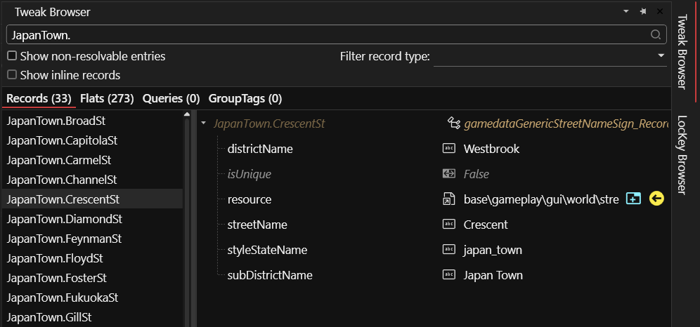<figcaption></figcaption></figure>


The vast majority of streets are named with what is shown on the sign followed by St, however there are some nonsense arbitrary exceptions and spelling differences for some signs.

For example, California Ave in Arasaka Waterfront has ID `ArasakaWaterfront.CaliforniaAve`, while Grant Ave in Charter Hill has ID `CharterHill.GrantSt`, and Milagro Trce in North Oak has ID `NorthOaks.MilagraTrce` (North Oak has an S at the end for all its signs, and it is MilagrO on the sign but MilagrA in the ID).


Right click on the ID in the list in WolvenKit and click Copy Tweak Name, then paste that in World Builder in the `streetNameSignTDBID` box and press enter. With any luck, the sign should now show the street name (the sign may be blurry, look away and look back to refresh the quality).

<figure>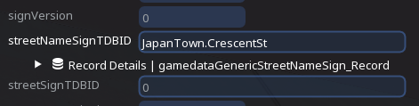<figcaption></figcaption></figure>

<figure>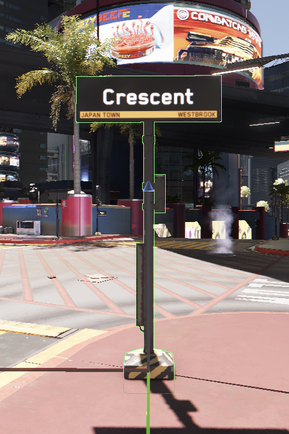<figcaption></figcaption></figure>


That is the process for setting data for a street sign. The process for a highway sign is pretty much the same, but there are some extra quirks to be aware of.


### Highway sign data

Because highway signs may consist of multiple signs grouped together on one pole, there can be multiple `StreetSignWidgetComponent | UI` entries. To be extra confusing, the number of those entries may not match the number of signs that are part of the entity... If you are setting data for one of those entries and nothing appears (and you are certain the ID is correct), you'll just have to trial and error another entry.

For example, here I have `highway_sign_a_3_5x1_v3`. It has one sign, yet contains two `StreetSignWidgetComponent | UI` entries. For this sign, editing `UI_1` does nothing, while `UI_2` works.


Highway signs use `streetSignTDBID`, unlike the smaller street signs which use `streetNameSignTDBID`.


<figure>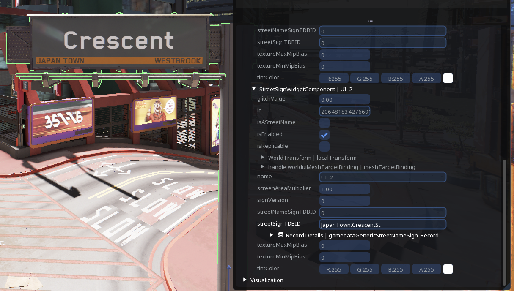<figcaption></figcaption></figure>

As another example, `highway_sign_ab` contains 4 signs; 2 lanes in each direction. It contains 12 entries, because each sign is actually 3 signs in disguise.

<figure>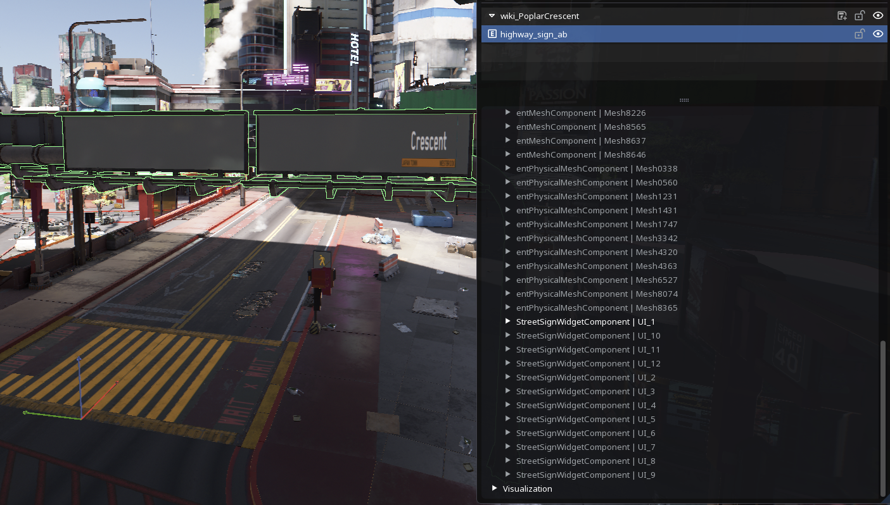<figcaption></figcaption></figure>

`highway_sign_db` is the same shape, but has the expected 4 entries. The signs corresponding to each `UI` number seem to go in a consistent direction, so once you figure out which one is `1` the rest should be easy to tell.

<figure>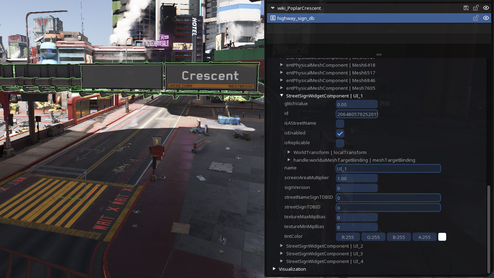<figcaption></figcaption></figure>

## Creating a new street name

Creating a street name requires creating a new TweakDB entry, which we will do with WolvenKit and TweakXL.

First create a new mod in WolvenKit if you do not already have one you are working on.

The simplest way to create a new name is to take an existing one and edit it. In WolvenKit, open the Tweak Browser (make sure it is visible in the `View` tab in the top menu toolbar). If you know what sub district your sign will be in, type that district with a `.` into the search bar, for example `JapanTown.`

<figure><figcaption></figcaption></figure>

Right click on an entry for a street name and click `Add TweakXL Override`. This will create a new file on the left (`signres` is the name of the mod I had open in WolvenKit; you should see your mod name there instead).

<figure>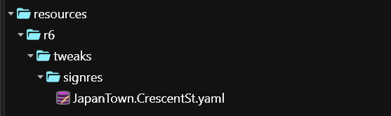<figcaption></figcaption></figure>

Right click this file and rename it to something sensible like your new name for that road (it doesn't _need_ to match the ID of the TweakDB entry). Open the file to edit in a text editor by clicking the blue icon.

The first line of the text file will be the TweakDBID for the entry - make sure to change it!


If you leave it as the ID of the entry you overrode, then all signs with that original ID will get the new data, and signs with your new ID will be blank because the new ID doesn't exist.


Change the data in the file as you wish. If you only want to change the street name, then change the value after `streetName:`

You can change the district/sub district here too - make sure to also change `styleStateName` which points to an entry in a file described [below](adding-street-name-signs-to-the-world.md#changing-district-colour-schemes). It is much easier to start by overriding a street that is in the district you want the new name to be in, which avoids having to change all this other stuff.


The street name and district text can be basically whatever you want; at least, it can be letters, numbers and spaces, I haven't tested special characters. The capitalisation of the text you write will be preserved.


Below I have changed the street name to show "Wiki", because I am very creative.

```
JapanTown.WikiSt:
  districtName: Westbrook
  isUnique: False
  resource: base\gameplay\gui\world\street_signs\generic_street_name\generic_street_name_sign.inkwidget
  streetName: Wiki
  styleStateName: japan_town
  subDistrictName: Japan Town
  $type: gamedataGenericStreetNameSign_Record
```

Close the game if you still have it open, and either click Install Mod in WolvenKit or manually place the `.yaml` file in `Cyberpunk 2077\r6\tweaks\`.

Start up the game, create a new sign in World Builder and give it your new ID. Hopefully you see your new name written on it.

<figure>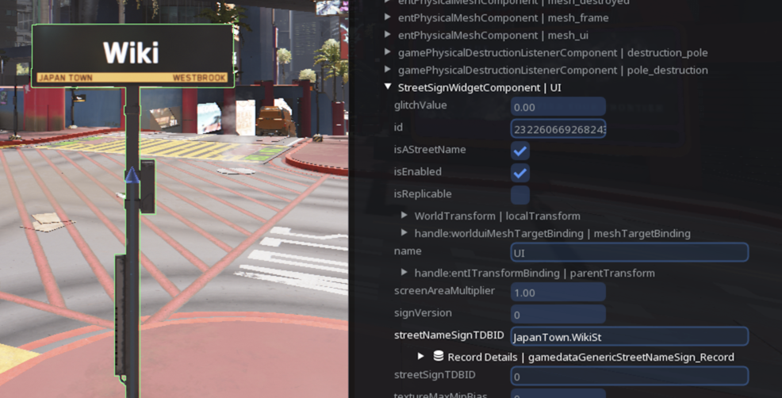<figcaption></figcaption></figure>

### The sign with my new name is blank

Make sure that:

* the first line of the `.yaml` file has been changed to your new ID
* the `.yaml` file is present in `Cyberpunk 2077\r6\tweaks\` (or a subfolder there, e.g. one named after your mod)
* the ID you have typed in World Builder is exactly the same as on the first line of the `.yaml` file (without the colon)
* the `styleStateName` entry is valid (see [here](adding-street-name-signs-to-the-world.md#sign-inkstyle-state))
* there are only letters, numbers and spaces used for the street and district names
* you have TweakXL installed
* the most recent log in `Cyberpunk 2077\red4ext\plugins\TweakXL` doesn't have any errors relating to your file


A custom sign has been added to the game, you can now repeat this for however many you wish. TweakXL will be a requirement of your mod.


## Changing district colour schemes

You may have noticed that the signs in the screenshots are different colours to vanilla (and as a result are actually readable). There is a single file which describes the colours for each part of the sign for each sub district; `base\gameplay\gui\world\street_signs\generic_street_name\generic_street_name_sign.inkstyle`

Open that file in WolvenKit (you can get to it more easily by just searching `generic_street_name_sign.inkstyle`). Double click it to add it to the mod, and then hover over it in the files on the left and click the blue icon to edit it.


While ArchiveXL can probably be used to edit the colours without conflicts between mods, there is no point. The file is small and does one specific thing, and it seems a very unlikely scenario that multiple mods would edit different parts of the file, and a user would want those edits combined.


Under `styles`, there are 18 entries - one for each sub district + a default.

<figure>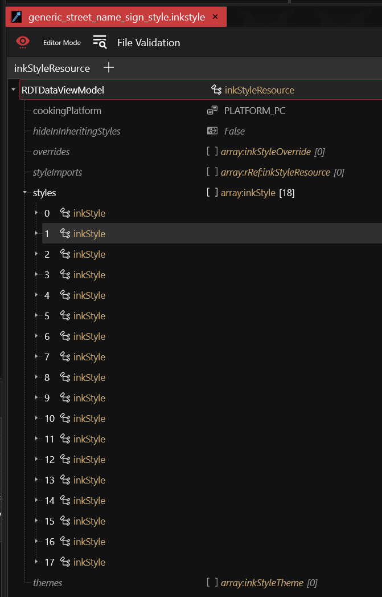<figcaption></figcaption></figure>

The styles are in _some sort_ of order; here is each sub district in alphabetical order with its number:

<table data-search="false"><thead><tr><th width="211.800048828125">Sub-district Name</th><th width="115.7999267578125" data-type="number">Style Index</th></tr></thead><tbody><tr><td>Default</td><td>0</td></tr><tr><td>Arasaka Waterfront</td><td>14</td></tr><tr><td>Arroyo</td><td>13</td></tr><tr><td>Badlands</td><td>16</td></tr><tr><td>Charter Hill</td><td>15</td></tr><tr><td>Coast View</td><td>4</td></tr><tr><td>Corpo Plaza</td><td>11</td></tr><tr><td>Downtown</td><td>10</td></tr><tr><td>Japan Town</td><td>9</td></tr><tr><td>Kabuki</td><td>8</td></tr><tr><td>Little China</td><td>7</td></tr><tr><td>North Oak</td><td>6</td></tr><tr><td>Northside Industrial</td><td>5</td></tr><tr><td>Rancho Coronado</td><td>12</td></tr><tr><td>The Glen</td><td>3</td></tr><tr><td>Vista del Ray</td><td>1</td></tr><tr><td>Wellsprings</td><td>2</td></tr><tr><td>West Wind Estate</td><td>17</td></tr></tbody></table>

Default is used by the sign entries that are common on highways saying a district is in a direction with arrows.

I will edit the style for Japan Town as an example. Expanding entry 9 and `properties`, we see 7 `inkStyleProperty` entries:

<figure>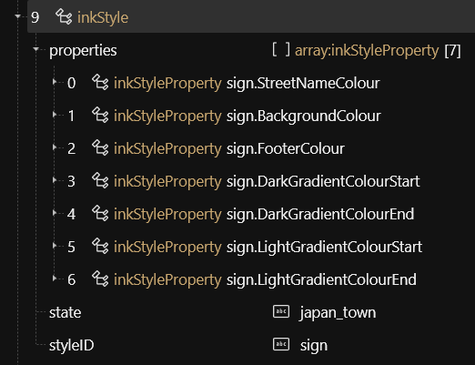<figcaption></figcaption></figure>

* `sign.StreetNameColour` - the main text of the street name
* `sign.BackgroundColour` - the colour of the background (duh). for highway signs, this applies additively on top of their grey background, so you cannot give them a black background (sad face emoji).
* `sign.FooterColour` - the bar at the bottom which has the district/sub district names
* The gradients do not appear to have an effect, so I will ignore them

Within each colour property, the value of each colour channel can be edited.

<figure>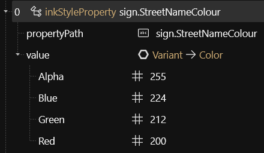<figcaption></figcaption></figure>


The colour channels are listed Alpha, Blue, Green, Red, which is probably the reverse of a colour picker you may be using. Make sure you put the right values in the right place.


### Sign `inkStyle` `state`

In the entry for each district, there is a value called `state`. This corresponds with `styleStateName` in the TweakDB entry for that sign's data (mentioned [here](adding-street-name-signs-to-the-world.md#creating-a-new-street-name)). This is how a sign decides what colour scheme it will use.

Save your changes to `generic_street_name_sign.inkstyle`, install the mod and start the game. Your beautiful new colours should take effect.

<figure>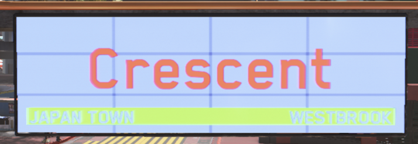<figcaption></figcaption></figure>

Here, I set the street name to fully red, the background to fully blue, and the footer to fully green. The colours may look different to what you expect, since the signs have a bit of luminence to them and they will go through tone mapping/colour filtering. It may take a bit of trial and error to get them how you want.


You can now change the sign colours to be readable. Hooray.


## Combining everything

We have seen how to add a sign to the world, give it a custom street name and edit the colour scheme. We can also add a new colour scheme to the list, use that in a custom street name, and use that on a newly added sign.

```
JapanTown.WikiSt:
  districtName: Westbrook
  isUnique: False
  resource: base\gameplay\gui\world\street_signs\generic_street_name\generic_street_name_sign.inkwidget
  streetName: Wiki
  styleStateName: wiki
  subDistrictName: Japan Town
  $type: gamedataGenericStreetNameSign_Record
```

<figure>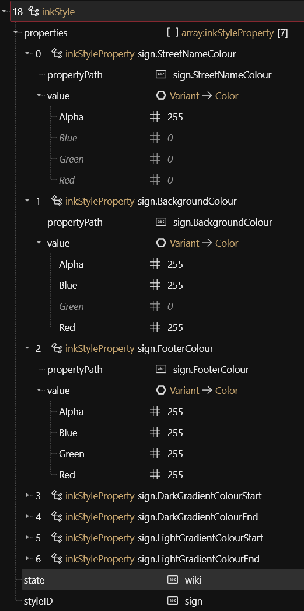<figcaption></figcaption></figure>

<figure>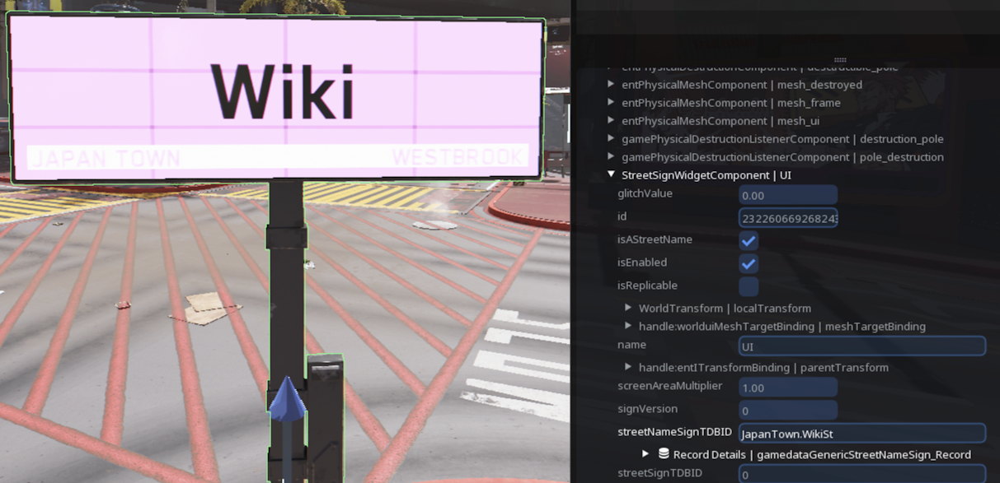<figcaption></figcaption></figure>

