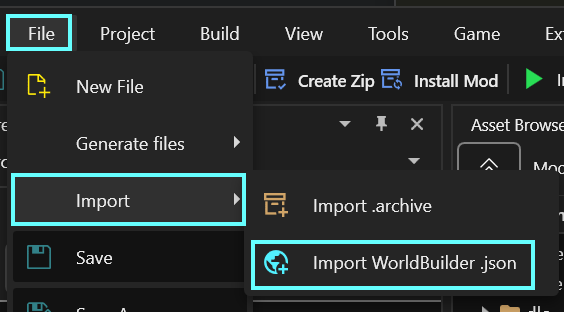

# Exporting to WolvenKit

## Summary

**Last documented edit:** November 11 2026 by [Akiway](https://github.com/Akiway)\
**Latest documented version of WB**: 2.0.0

While you build, World Builder keeps your work in its own format, made for editing. To turn it into a mod that other players can install, you **export** it, then **import** the result into WolvenKit. WolvenKit then builds the real game files.

This guide walks you through the whole process, step by step.

### Wait, that's not what I want!

* For what each button and option of the Export tab does, see [Tab: Export](ui-tabs-explained/tab-export.md)
* To learn how to split a big build into several parts, see [Project Structure](project-structure.md)
* To make parts of your build switchable in game, see [Creating Sector Variants](features-and-guides/creating-sector-variants.md)

### Requirements

#### Tools

* [**World Builder**](https://wiki.redmodding.org/cyberpunk-2077-modding/modding-guides/world-editing/object-spawner) **(**[**GitHub**](https://github.com/justarandomguyintheinternet/CP77_entSpawner/releases/latest)**|**[**Nexus**](https://www.nexusmods.com/cyberpunk2077/mods/20660)**) -** 2.0.0 or newer
* [**ArchiveXL**](https://wiki.redmodding.org/cyberpunk-2077-modding/for-mod-creators-theory/core-mods-explained/archivexl) **(**[**GitHub**](https://github.com/psiberx/cp2077-archive-xl/releases)**|**[**Nexus**](https://www.nexusmods.com/cyberpunk2077/mods/4198)**)** - 1.28.1 or newer
* **Codeware (**[**GitHub**](https://github.com/psiberx/cp2077-codeware/releases)**|**[**Nexus**](https://www.nexusmods.com/cyberpunk2077/mods/7780)**) -** 1.21.2 or newer
* **WolvenKit (**[**GitHub**](https://github.com/WolvenKit/WolvenKit/releases)**|**[**Nexus**](https://www.nexusmods.com/cyberpunk2077/mods/2201)**)** - 10.0.0 or newer
* [WolvenKit Resources plugin](https://wiki.redmodding.org/wolvenkit/wolvenkit-app/home/home-plugins#wolvenkit-resources)

Only if your build uses them:

* UnlimitedGeometryCacheStreaming **(**[**GitHub**](https://github.com/notaspirit/UnlimitedGeometryCacheStreaming/releases)**|**[**Nexus**](https://www.nexusmods.com/cyberpunk2077/mods/29096)**)**
* [**TweakXL**](https://wiki.redmodding.org/cyberpunk-2077-modding/for-mod-creators-theory/core-mods-explained/tweakxl) **(**[**GitHub**](https://github.com/psiberx/cp2077-codeware/releases)**|**[**Nexus**](https://www.nexusmods.com/cyberpunk2077/mods/7780)**)**

#### Knowledge

* You know how to create a project in WolvenKit
* You have built and saved something with World Builder (see [Quick Start](quick-start.md))

***

## How it works

### Groups become sectors

The game world is made of **sectors** (`.streamingsector` files). Each one holds the objects of one area.

* Each saved root group you export becomes **one sector** in your mod
* A mod can contain as many sectors as you want
* ArchiveXL tells the game to load your sectors, through a `.xl` file that the export creates for you

### Streaming ranges

The game doesn't load the whole world at once. Two settings decide when your objects appear :

| Setting                      | Where to find it                                                                                                                                                                                                        | What it does                            |
| ---------------------------- | ----------------------------------------------------------------------------------------------------------------------------------------------------------------------------------------------------------------------- | --------------------------------------- |
| **Asset streaming distance** | [<mark style="color:purple;">Spawned tab</mark>](ui-tabs-explained/tab-spawned.md) <i class="fa-folder-tree" style="color:purple;">:folder-tree:</i> , in each asset's **World Node** header                            | At what distance that one asset appears |
| **Sector streaming box**     | [<mark style="color:purple;">Export tab</mark>](ui-tabs-explained/tab-export.md) <i class="fa-arrow-right-from-bracket" style="color:purple;">:arrow-right-from-bracket:</i> , in each group's **Streaming Box** header | When the whole sector is loaded         |

The two work together : an asset only shows when its sector is loaded **and** you're within its own range. If the player leaves the streaming box, everything in that sector disappears, whatever the assets' own streaming distance.


**Why this matters :** if your build has parts far away from each other, put each part in its own root group. Each part then becomes its own sector, and the game only loads the parts the player is near. Project Structure explains this with an example.


#### Asset streaming distance

<figure><figcaption><p>Export tab - Asset's streaming distance</p></figcaption></figure>

#### Sector streaming box

<figure><figcaption><p>Export tab - Sector's streaming box</p></figcaption></figure>

## Processus



### Step 1: Prepare the export

1. **Save** every root group you want in your mod (`CTRL-S` in the [<mark style="color:purple;">Spawned tab</mark>](ui-tabs-explained/tab-spawned.md) <i class="fa-folder-tree" style="color:purple;">:folder-tree:</i> saves them all)
2. In the [<mark style="color:purple;">Projects tab</mark>](ui-tabs-explained/tab-saved.md) <i class="fa-floppy-disk" style="color:purple;">:floppy-disk:</i>, click <mark style="color:purple;">**Add to Export**</mark> on each of these groups
   * If your groups are in a project, click the project's export button instead : it adds them all at once
3. Go to the [<mark style="color:purple;">Export tab</mark>](ui-tabs-explained/tab-export.md) <i class="fa-arrow-right-from-bracket" style="color:purple;">:arrow-right-from-bracket:</i>
4. Type a **Project Name**. It becomes the name of your mod's folder and files, so keep it short and unique (for example `yourname_myplace`).
5. Open each group and check its settings:
   * **Sector Category**: if you're not sure, pick **Interior** or **Exterior**
   * **Streaming Box**: the easiest is to tick **Auto on Export**, which sizes the box from the group's content each time you export. Tick **Visualize** to see the box in the world.
   * **Variants**: only if you want parts of the build to be switchable
6. Click <mark style="color:purple;">**Save as Template**</mark>, so you don't have to redo this setup next time

Every option is explained on the Tab: Export page.



### Step 2: Export

1. Click <mark style="color:purple;">**Full export**</mark>
2. If World Builder finds a problem in your build, it pauses and tells you what's wrong. Fix it and export again. The list of checks is on the Tab: Export page.
3. When it's done, you'll find your export in:

```
Cyberpunk 2077\bin\x64\plugins\cyber_engine_tweaks\mods\entSpawner\export\yourProjectName_exported.json
```



### Step 3: Import into WolvenKit

1. Open your WolvenKit project (or create a new one)
2.  In the top menu, go to **File** > **Import** > **Object Spawner .json**

    * If the entry is greyed out, install the [WolvenKit Resources plugin](https://wiki.redmodding.org/wolvenkit/wolvenkit-app/home/home-plugins#wolvenkit-resources)

    <figure><figcaption><p>Click the "Import object spawner .json" button, then choose the file</p></figcaption></figure>
3. In the file dialog, choose your previously exported file `yourProjectName_exported.json` file

WolvenKit creates these files in your project:

| File                                                   | What it is                                                         |
| ------------------------------------------------------ | ------------------------------------------------------------------ |
| `yourProjectName\sectors\<group name>.streamingsector` | One per exported group: the content of your build                  |
| `yourProjectName\all.streamingblock`                   | The list of your sectors and their streaming boxes                 |
| `yourProjectName.xl` (in the resources)                | Tells ArchiveXL to load your sectors                               |
| `yourProjectName\custom_devices.devices` and `.psrep`  | Only if your build has devices with connections, such as elevators |


If the export folder also contains `yourProjectName_interactions.yaml`, your build uses a sound system with custom interactions. Add this file to your WolvenKit project under `resources\r6\tweaks\`, so it ships with your mod. It needs TweakXL.




### Step 4: Install and test

1. In WolvenKit, click **Install** in the top bar
2. **Restart the game.** ArchiveXL only adds new sectors when the game starts, so reloading mods or a save isn't enough.
3. Go to your build's location and check that everything is there


Your build now shows twice: once from your mod, once from World Builder if your groups are still loaded. To check the real result, hide or unload your groups in World Builder.




## Updating your mod

When you change your build later:

1. Save your groups in World Builder
2. In the [<mark style="color:purple;">Export tab</mark>](ui-tabs-explained/tab-export.md) <i class="fa-arrow-right-from-bracket" style="color:purple;">:arrow-right-from-bracket:</i> , load your template if needed, then click <mark style="color:purple;">**Update existing export**</mark>. It only rebuilds the groups you changed, so it's faster than a full export.
3. Import the new `_exported.json` into WolvenKit again. The new files replace the old ones.
4. Install, then restart the game.


If you removed a group from the export, its old `.streamingsector` file stays in your WolvenKit project. The game no longer loads it, but you can delete it to keep your mod clean.



#### **Updating your removals and mutations for a new game version ?**

Check out the guide on how to [update your ArchiveXL \`.xl\` files for a new game version](../removing-objects/updating-.xl-files-for-a-new-game-version.md)


## Common Mistakes

| Mistake                                                    | What you'll see                                                           | Fix                                                                        |
| ---------------------------------------------------------- | ------------------------------------------------------------------------- | -------------------------------------------------------------------------- |
| The game wasn't restarted after installing                 | Nothing from your mod in the world, no error                              | Restart the game, not only the save                                        |
| Streaming box too small                                    | Parts of your build disappear when you walk away, or pop in late          | Tick **Visualize** to check the box, or use **Auto on Export**             |
| Object streaming range too small                           | One object appears only when you're very close                            | Raise its range in the object's **World Node** header, or use **Auto-Set** |
| Everything in one root group, for a build spread far apart | The whole build is loaded even when the player is far away                | Split it into several root groups (Project Structure)                      |
| UnlimitedGeometryCacheStreaming not installed              | Collision Meshes don't block the player                                   | Install it, and list it as a requirement of your mod                       |
| WolvenKit is outdated                                      | The import fails with "requires import script version … or higher"        | Update WolvenKit                                                           |
| Assets tagged **DLC** or **Mod** in the Spawn New list     | Players without Phantom Liberty, or without that mod, see missing objects | List them as requirements, or pick base game assets                        |
| **Force export** used to skip a problem                    | The objects concerned don't work in game                                  | Fix the problem instead, then export again                                 |

## What You Can Do With This

* Publish your build as a standalone mod, which only needs ArchiveXL to run.
* Make parts of it switchable with [sector variants](features-and-guides/creating-sector-variants.md).
* Keep building: save a template once, then use <mark style="color:purple;">**Update existing export**</mark> each time you change something.
