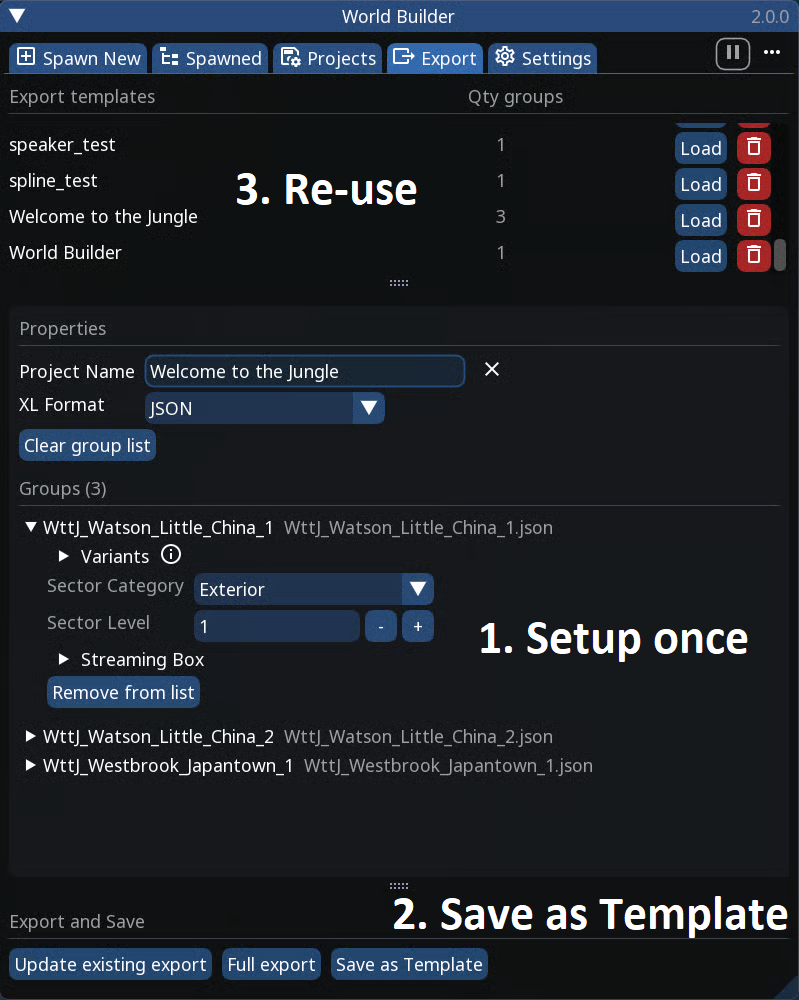

# Tab: Export

## Summary

**Published:** by [keanuWheeze](https://github.com/justarandomguyintheinternet)\
**Last documented edit:** November 11 2026 by [Akiway](https://github.com/Akiway)\
**Latest documented version of WB**: 2.0.0

This page explains every button and option of the Export tab, from top to bottom.

### Wait, that's not what I want!

* To learn how to go from your build to a working mod, step by step, follow [Exporting to WolvenKit](../exporting-from-object-spawner.md). It also explains what sectors and streaming ranges are.
* For variants in depth, see [Creating Sector Variants](../features-and-guides/creating-sector-variants.md)

***

## Export templates

A template remembers your whole export setup: the groups in the list, all their settings, the project name and the XL format.

<table><thead><tr><th width="179">Action</th><th>How</th></tr></thead><tbody><tr><td>Create a template</td><td>Set everything up, then click <mark style="color:purple;"><strong>Save as Template</strong></mark> at the bottom of the tab</td></tr><tr><td>Use a template</td><td>Click <mark style="color:purple;"><strong>Load</strong></mark> next to it, or double-click its row</td></tr><tr><td>Delete a template</td><td>Click the <i class="fa-trash" style="color:$danger;">:trash:</i> button next to it</td></tr></tbody></table>

* The number next to each template is how many groups it contains
* Loading a template adds its groups to the current list. Groups already in the list are not added twice.
* Templates are saved in `Cyberpunk 2077\bin\x64\plugins\cyber_engine_tweaks\mods\entSpawner\data\exportTemplates`

<figure><figcaption>
Export tab - Overview
</figcaption></figure>

## Properties

| Option               | What it does                                                                     |
| -------------------- | -------------------------------------------------------------------------------- |
| **Project Name**     | The name of your export, used for its file and folder names. Required to export. |
| **XL Format**        | Writes the `.xl` file in JSON or YAML. Both work the same in game.               |
| **Clear group list** | Removes every group from the list. Your saved groups are not touched.            |

## Groups

Groups get into this list from the [<mark style="color:purple;">Projects tab</mark>](tab-saved.md) <i class="fa-floppy-disk" style="color:purple;">:floppy-disk:</i>, with <mark style="color:purple;">**Add to Export**</mark> (one group) or a project's export button (all its groups).

Click a group to open its settings. The grey text next to its name is the file the group comes from.

### Variants

| Option               | What it does                                                                                                                                                          |
| -------------------- | --------------------------------------------------------------------------------------------------------------------------------------------------------------------- |
| **Variant Node Ref** | A unique name for this group's variants, for example `$/#yourname_myplace`. Needed to switch them on and off.                                                         |
| **Variant name**     | One row per group placed directly inside the root group. Leave it empty (or type `default`) to keep that part always visible, or give it a name to make it a variant. |
| **Default state**    | Whether the variant is **Visible** or **Hidden** when the game starts                                                                                                 |

* Everything placed directly in the root group, outside any sub-group, is always visible
* Rows with the same variant name switch together
* The default state of a newly named variant comes from the **Settings** tab

### Sector settings

| Option              | What it does                                                                                                                  |
| ------------------- | ----------------------------------------------------------------------------------------------------------------------------- |
| **Sector Category** | The type of sector. If you're not sure, use **Interior** or **Exterior**. Some categories show an extra **Prefab Ref** field. |
| **Sector Level**    | The level of the sector, from 0 to 6. Keep the default unless you know you need another one.                                  |

### Streaming Box

The streaming box is the area in which the game loads this group's sector. It's centered on the group's content.

| Option                          | What it does                                                                                                                              |
| ------------------------------- | ----------------------------------------------------------------------------------------------------------------------------------------- |
| **Visualize**                   | Draws the box in the world, so you can see how big it is                                                                                  |
| **Distance Preset** + **Apply** | Sets the box to a common size (see the table below). Turns off **Auto on Export**.                                                        |
| **Auto on Export**              | Recomputes the box size from the group's content every time you export. The size fields are then locked, and show the last computed size. |
| **Box Extents**                 | The size of the box on each axis. It extends that far in both directions from the center.                                                 |
| **Auto**                        | Computes a size once, from the group's content                                                                                            |

**Auto** and **Auto on Export** make the box cover every object of the group plus its own streaming range (up to 250), with a 20% safety margin.

| Preset      | Good for                                                                      |
| ----------- | ----------------------------------------------------------------------------- |
| Interior    | Small rooms and indoor props, loaded only when close                          |
| Street      | Regular city assets, visible from nearby streets                              |
| District    | Large city chunks, visible across a district                                  |
| Landscape   | Big outdoor landmarks, visible from far away                                  |
| To the Moon | Always loaded, wherever the player is. Use it only for very important things. |

The arrows icon at the end of the **Box Extents** row is **green** when you're inside the box and **red** when you're outside. Hover it to see your distance to the group.

<figure><figcaption>
Export tab - Streaming box visualized
</figcaption></figure>

### Remove from list

Removes the group from the export list only. The saved group stays in the Projects tab.

## Export and Save

| Button                     | What it does                                                          |
| -------------------------- | --------------------------------------------------------------------- |
| **Update existing export** | Rebuilds only the groups that changed since your last export. Faster. |
| **Full export**            | Rebuilds every group from scratch                                     |
| **Save as Template**       | Saves the current setup as a template (see Export templates)          |

* The buttons are greyed out until the list has at least one group and you have typed a **Project Name**
* If an update isn't possible (for example if you never did a full export of this project, or World Builder was updated since then), World Builder warns you and does a full export instead
* A warning appears above the buttons if two groups in the list have the same name. Rename one of them in the Projects tab to avoid confusion.

What to do with the exported file is explained in Exporting to WolvenKit.

### Problems found during the export

Before writing anything, World Builder checks your build for common mistakes:

<table><thead><tr><th width="338">Problem</th><th>Usually means</th></tr></thead><tbody><tr><td>Duplicated NodeRefs</td><td>Two objects share the same NodeRef. Each NodeRef must be unique.</td></tr><tr><td>Missing Outline Markers</td><td>An area node has no outline, often because its outline group was renamed or moved</td></tr><tr><td>Missing Spline Points</td><td>A spline has no points, often for the same reason</td></tr><tr><td>Empty Spline NodeRef / Empty AISpot NodeRef</td><td>The object has no NodeRef, so nothing can use it</td></tr><tr><td>Community Referencing Missing NodeRef</td><td>A community entry points to a spot that isn't in this export. It can still work if that spot is in another export.</td></tr><tr><td>Unresolved Marking</td><td>A community marking matches no AI Spot</td></tr><tr><td>Missing Initial Phase</td><td>A community entry starts on a phase that doesn't exist</td></tr><tr><td>Missing Conversation Workspots</td><td>A conversation area has no workspots, so nobody can play its scenes</td></tr><tr><td>Missing Elevator Floor Setup</td><td>An elevator isn't fully set up</td></tr><tr><td>Sound System Setup</td><td>A sound system will export but won't play as set up</td></tr><tr><td>Infinite Patrol Workspot</td><td>An AI Spot used as a patrol point has <strong>Is Infinite</strong> on, so the NPC would stop there forever</td></tr></tbody></table>

Problems are shown one at a time. For each one you can click:

* **OK**: stop the export so you can fix the problem
* **Force export**: export anyway
* **Fix & continue** (only for some problems): World Builder fixes it for you and goes on. You can undo the fix.


Only use **Force export** if you're sure the problem doesn't matter for your mod. In most cases, the objects concerned won't work in game.

